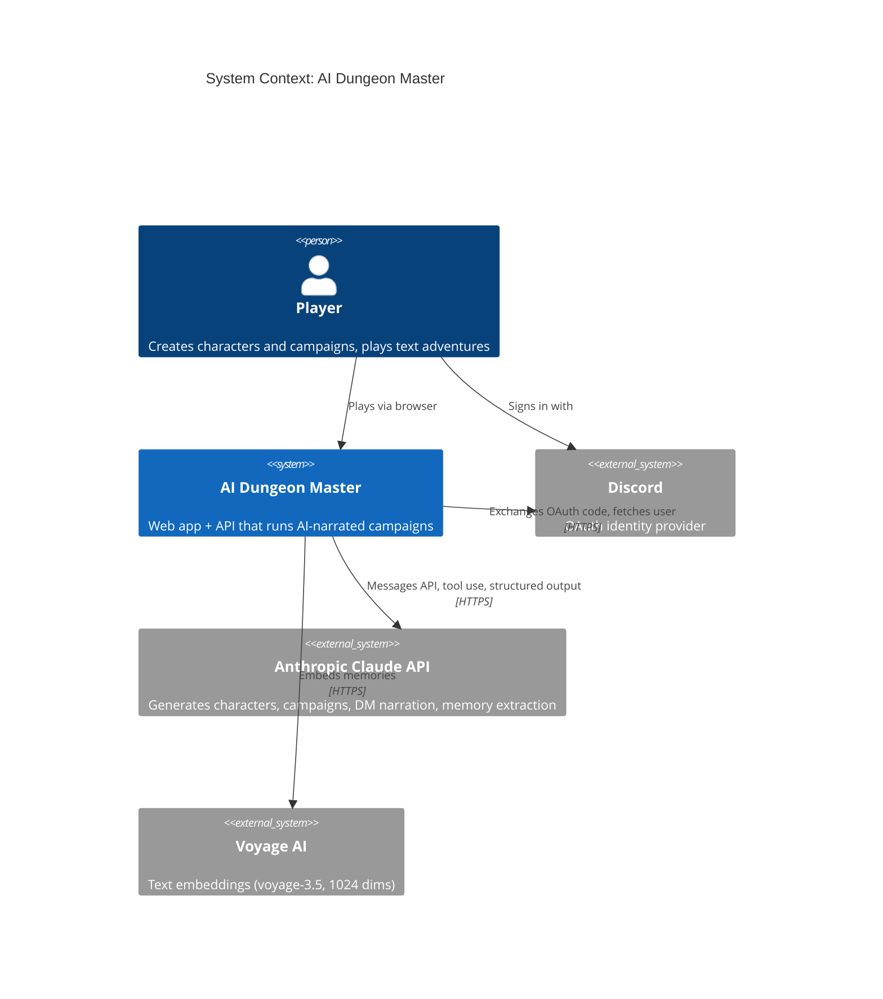
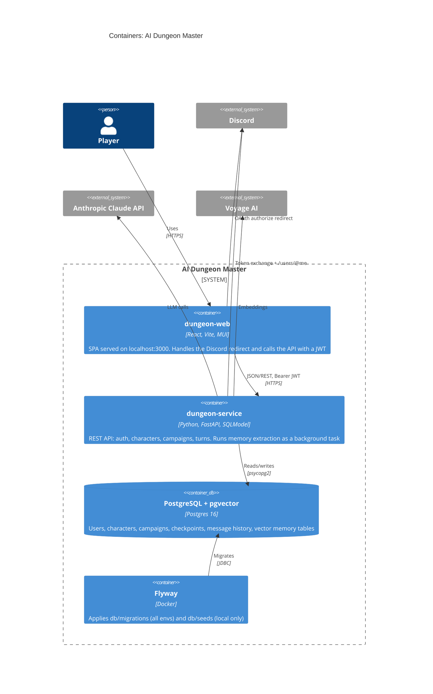
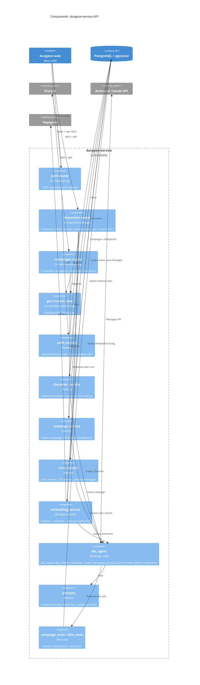
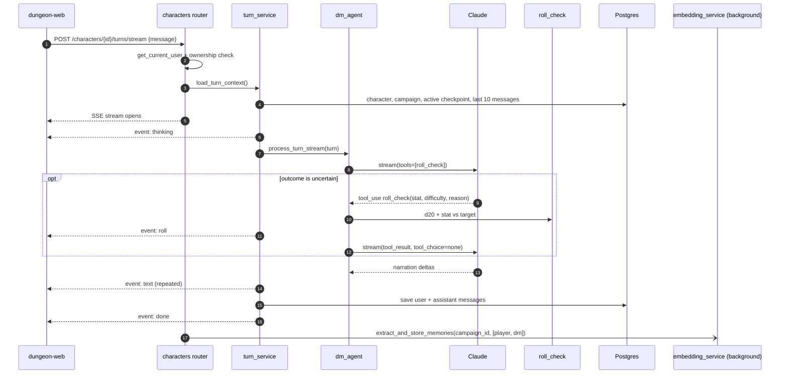
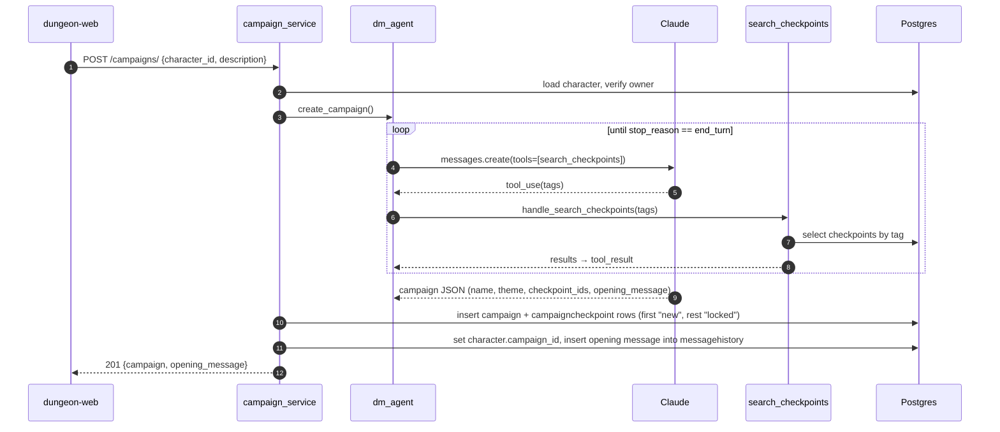
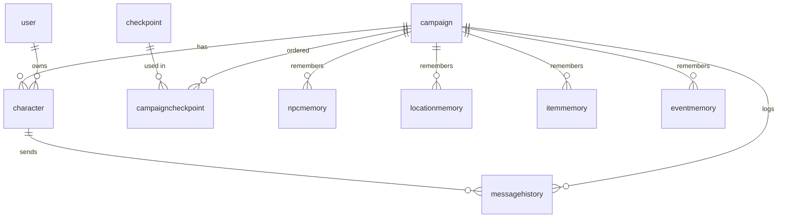

# Architecture

C4 diagrams for the dungeon service. They're written in Mermaid and render on GitHub. Update them when containers, external systems, or service boundaries change.

## Level 1: System Context

## Level 2: Containers

## Level 3: Components (dungeon-service)

## Dynamic: Playing a turn

Rolls are never stored. Memories are written after every turn, but nothing reads them back into the turn prompt yet.

## Dynamic: Creating a campaign

## Data model

