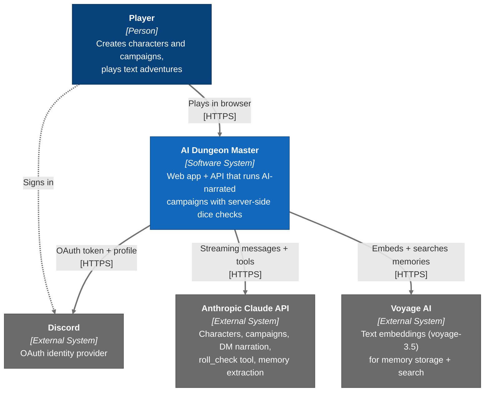
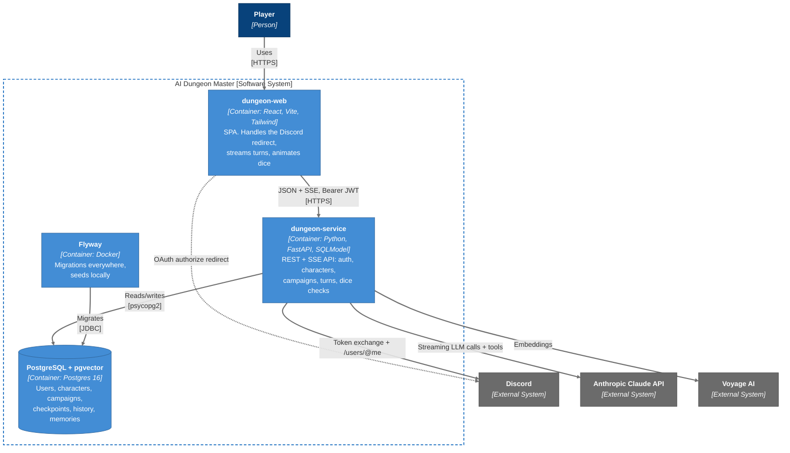
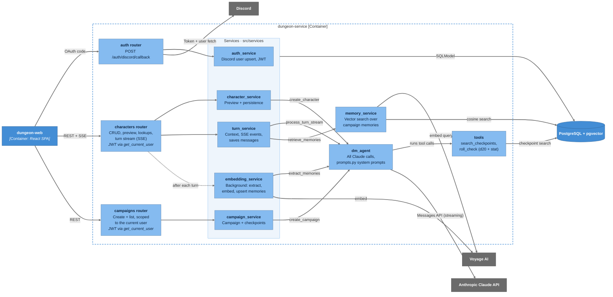
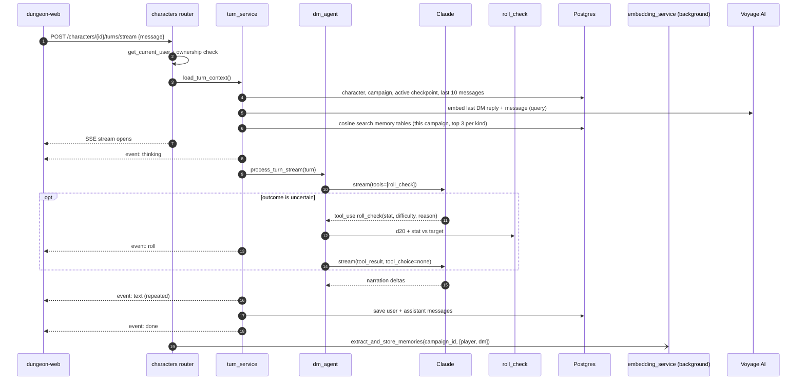
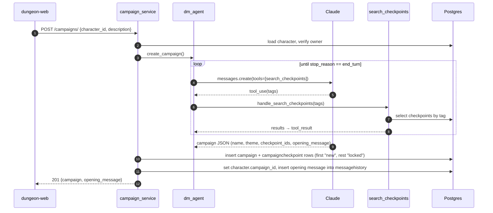
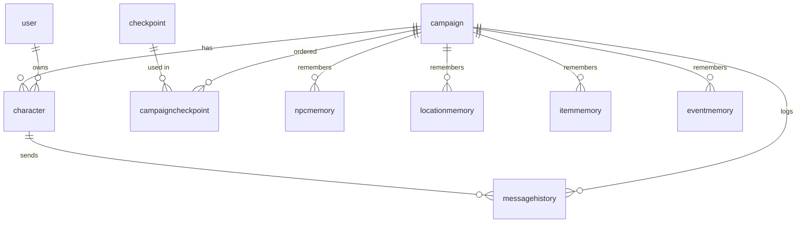

# Architecture

C4 diagrams for the dungeon service, written in Mermaid so they render on GitHub. Update them when containers, external systems, or service boundaries change.

The three C4 levels use Mermaid `flowchart` with C4 colours rather than Mermaid's `C4Context` diagrams. The C4 renderer doesn't route lines around boxes, so its labels overlap and lines cross through shapes. Legend: dark blue = person, blue = our system / containers, light blue = components, grey = external systems. Dashed lines are browser redirects or background work.

## Level 1: System Context

## Level 2: Containers

## Level 3: Components (dungeon-service)

The services all read and write Postgres through SQLModel, shown as a single edge from the Services group.

## Dynamic: Playing a turn

Rolls are never stored. Memories are written after every turn and searched before the next one; the matches go into the DM's system prompt. If the memory lookup fails, the turn continues without them.

## Dynamic: Creating a campaign

## Data model

